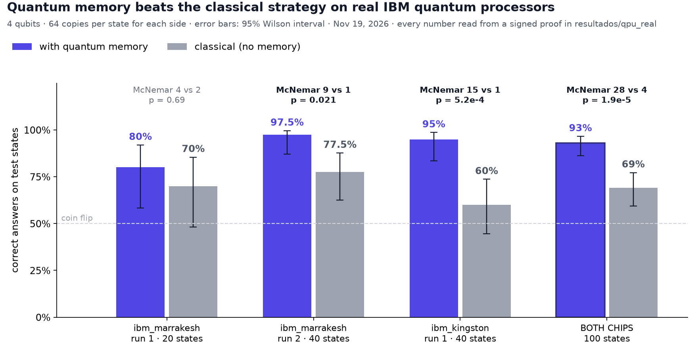
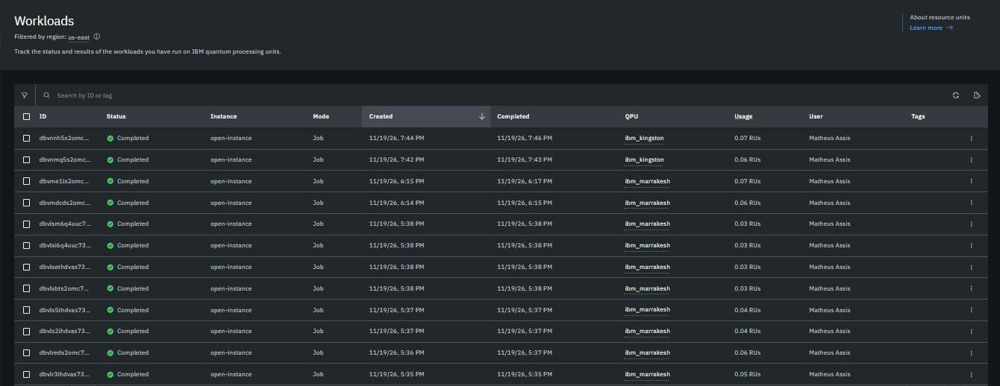
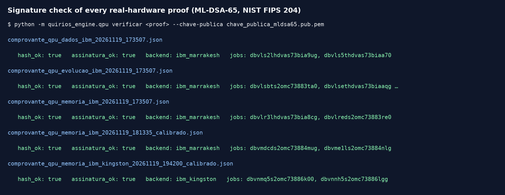

# QURIOS Engine

> 🇺🇸 [English version, results first](README.md) · 🇧🇷 Documentação completa em português (esta página)

Infraestrutura entre o software clássico e o software quântico. Um programa
comum fala com o QURIOS por interfaces que já conhece (`fit`/`predict` em
Python ou JSON por HTTP). O QURIOS monta o circuito, escolhe onde executá-lo
(simulação exata, tensor network, Qiskit Aer ou processador IBM real),
treina, controla jobs longos e devolve números clássicos. Ele também decide,
com evidência estatística, quando o quântico vale a pena e quando o clássico
resolve melhor, e **evolui os próprios circuitos sozinho, dentro de um
circuito quântico**: a população de arquiteturas vive em superposição, e o
circuito só troca o campeão em uso quando a melhora é comprovada. E mede,
com o mesmo número de experimentos para os dois lados, onde o quântico vence
o clássico: **aprender com dados quânticos usando memória quântica**.

O que ele melhora (IA e sistemas), os princípios e as camadas estão em
[ARQUITETURA.md](ARQUITETURA.md); a proteção, em [SEGURANCA.md](SEGURANCA.md).

## Situação hoje

Cada número deste projeto saiu de uma execução, e cada um diz onde foi medido.

| Resultado | Onde está medido |
|---|---|
| Aprender com memória quântica: 98% contra 49% sem memória (6 qubits, mesmo número de cópias) | Simulação exata |
| A mesma tarefa em **dois computadores quânticos reais** da IBM, 3 execuções, 100 estados (4 qubits, 64 cópias para cada lado): **93% contra 69%** | ibm_marrakesh e ibm_kingston, 19/11/2026, comprovantes assinados. **McNemar pareado: 28 contra 4, p = 0,00002** |
| Por chip: ibm_marrakesh 91,7% contra 75% (60 estados, p = 0,021); ibm_kingston 95% contra 60% (40 estados, p = 0,0005) | A vantagem se repetiu num segundo chip, com estados novos |
| Prova completa na QPU real: 3 experimentos, 8 jobs, **22 s de QPU**. Dados preparados no chip: empate (80% contra 80%). Evolução sorteada no chip: 92,5% contra 88,7% do circuito padrão (o campeão não usa portas de 2 qubits) | QPU da IBM, comprovantes em `resultados/qpu_real/` |
| Camada de IA em rede tensorial: MNIST 35× menor, 97,46% contra 97,34% do original | CPU (PyTorch) |
| Dados clássicos na QPU: foto 128×128 com 68× menos portas de 2 qubits | Circuitos compilados, fidelidade calculada |
| Quantização guiada pelos dados (4 bits por peso): a perda de qualidade do arredondamento comum cai **pela metade**. Qwen2.5-0.5B: de +22% para **+11%**; SmolLM2-135M: de +18% para **+7,5%**. Em 3 bits, de +310% para +62% | GPU T4 (Qwen) e CPU (SmolLM2) |
| Modelo de linguagem nativo em rede tensorial | CPU: vence a fatoração clássica, mas perde para um modelo denso mais estreito. GPU (T4): denso 1,947 contra TT 2,329 bits/caractere com 6,1× menos parâmetros; a versão completa roda agora |
| Encolher um modelo pronto com rede tensorial (Qwen 0,5B) | GPU (T4): 1,27× menor, mas a perplexidade vai de 18,7 para 28,7 e a conversa se perde. **Não compete** com a quantização; ficou como pesquisa |
| Adaptador de ajuste fino em rede tensorial contra LoRA | **O LoRA ganhou** na CPU (SmolLM2) e na GPU (Qwen 0,5B: 2,379 contra 2,469 com os mesmos parâmetros). Caminho testado e **descartado** |
| Proteção (sem chave não sobe, trilha assinada, cofre pós-quântico) | 344 testes, incluindo ataques a cada camada |

**Visão de longo prazo, não resultado:** levar parte do treino de IA dos
clusters de GPU para processadores quânticos, quando o hardware permitir.

```
 agentes de IA (MCP) ──┐
 software clássico ────┴─► API HTTP / Python
                           │
                     Orquestrador ── clássico ou quântico? (validação cruzada + teste estatístico)
                           │
          Auto-evolução ── busca de arquitetura + campeões promovidos só com evidência
                           │
     Treino / Kernels ── parameter-shift | SPSA | kernel projetado auto-calibrado
                           │
               Ansatz (genoma) ── ângulo | IQP | amplitude · Rx/Ry/Rz · CNOT/CZ/RZZ · leitura Z/Pauli
                           │
     Backend ── exato (≤24 qubits) | MPS (50–100+) | Aer | hardware futuro | IBM real
                │  medição por bases ou sombras clássicas · mitigação de leitura + ZNE
                           │
       Tarefas ── enviar agora, buscar depois        Assinatura pós-quântica ML-DSA
```

## Estrutura

```
quirios_engine/
├── quirios_engine/
│   ├── core.py          portas, CNOTs como permutação, topologias, QuantumConfig
│   ├── ansatz.py        o circuito como genoma (codificação, rotações, emaranhador, leitura)
│   ├── backends.py      contrato Backend, exato/MPS/Qiskit, sombras, mitigação, ZNE, plugins
│   ├── tarefas.py       execução assíncrona (Tarefa, jobs IBM recuperáveis)
│   ├── otimizadores.py  ParameterShift e SPSA
│   ├── vqc.py           VQCClassifier (treino, persistência assinável)
│   ├── kernels.py       kernels quânticos de fidelidade e projetado, alinhamento, concentração
│   ├── evolucao.py      auto-evolução: busca de arquitetura + registro de campeões (CLI)
│   ├── evolucao_quantica.py  evolução dentro de um circuito gerador (superposição + emaranhamento)
│   ├── dados_quanticos.py    fases de Ising: benchmark com dados quânticos (CLI)
│   ├── ibm_estimador.py      Estimator da IBM com mitigação e operator backpropagation
│   ├── agendamento.py        evolução contínua agendada (CLI)
│   ├── memoria_quantica.py   aprender com memória quântica: vantagem medida, mesmas cópias (CLI)
│   ├── redes_tensoriais.py   TT/MPS: compressão de matrizes e dados clássicos -> circuitos (CLI)
│   ├── ia_tensorial.py       camadas TT em PyTorch: modelos de IA comprimidos e acelerados (CLI)
│   ├── llm_nativo.py         modelo de linguagem que nasce em rede tensorial, comparação justa (CLI)
│   ├── llm_tensorial.py      modelo de linguagem já treinado, comprimido e curado por destilação (CLI)
│   ├── quantizacao.py        quantização de pesos guiada pelos dados, com correção de posto baixo
│   ├── adaptadores.py        ajuste fino: adaptador em rede tensorial contra LoRA, comparação justa (CLI)
│   ├── forja.py              forja quântica: um circuito quântico desenha a rede de IA (CLI)
│   ├── protecao.py           proteção em camadas: chaves com escopo, contenção, auditoria, cofre ML-KEM, guarda de agentes (CLI)
│   ├── conta_ibm.py          liga a conta da IBM Quantum sem expor a chave (CLI)
│   ├── qpu.py           execução na QPU com comprovante assinado (CLI)
│   ├── painel.py        painel ao vivo da evolução quântica (servido pela API)
│   ├── futuro.py        gerações de hardware e curva de prontidão
│   ├── diagnostico.py   termômetro de barren plateau, estimativa de circuitos
│   ├── entropy.py       entropia de medição/emaranhamento, mutual information, pureza
│   ├── sistema.py       geradores de features (Brutos, RFF, Quantico) + ClassificadorQURIOS
│   ├── orquestrador.py  Orquestrador clássico/quântico e roteamento de backend
│   ├── estatistica.py   distribuição t e teste pareado (sem scipy)
│   ├── benchmark.py     benchmark contínuo com histórico (CLI)
│   ├── seguranca.py     assinatura pós-quântica ML-DSA-65 (FIPS 204)
│   ├── mcp_servidor.py  servidor MCP para agentes de IA
│   └── api.py           API HTTP (FastAPI)
├── tests/               suíte pytest (tests/e2e: ponta a ponta e estresse)
├── exemplos/            fases_1_a_4.py, fase_5.py, rodar_na_ibm.py, gerar_dados_investidores.py,
│                        kaggle_llm_tensorial.ipynb (modelos de linguagem na GPU grátis: Kaggle ou Colab)
├── ARQUITETURA.md       o que o QURIOS melhora, princípios e camadas
├── SEGURANCA.md         ameaças, camadas de proteção e o que fica para a implantação
└── .github/workflows    CI (Linux e Windows, Python 3.10–3.12)
```

## Instalação

Python 3.10 ou mais novo.

```bash
git clone <repo>
cd quirios_engine
python -m venv .venv
.venv\Scripts\activate            # Windows  (Linux/macOS: source .venv/bin/activate)
pip install -e .                  # núcleo (numpy + numba)
pip install -e ".[classico]"      # + scikit-learn (benchmark, exemplos)
pip install -e ".[qiskit]"        # + Qiskit, Aer (MPS) e IBM Runtime
pip install -e ".[api]"           # + FastAPI e uvicorn
pip install -e ".[mcp]"           # + servidor MCP para agentes de IA
pip install -e ".[pqc]"           # + assinatura pós-quântica (cryptography >= 48)
pip install -e ".[ibm]"           # + operator backpropagation (qiskit-addon-obp)
pip install -e ".[qiskit,api,classico,mcp,pqc,ibm,dev]"   # tudo, para desenvolver
```

> No Windows, se o projeto estiver numa pasta do OneDrive, crie o ambiente
> virtual fora dela (ex.: `python -m venv C:\venvs\quirios`). Caminhos com
> mais de 260 caracteres impedem o numba de carregar, e o OneDrive não
> precisa sincronizar centenas de MB de dependências.

Para ver tudo funcionando com dados reais:

```bash
python exemplos/fases_1_a_4.py
python exemplos/fase_5.py
```

## Uso básico

```python
from quirios_engine import QuantumConfig, VQCClassifier

config = QuantumConfig(n_qubits=8, topologia="anel", n_camadas_entrelacamento=2)
clf = VQCClassifier(config, lr=0.3, epocas=20, seed=42)
clf.fit(X_treino, y_treino)              # X em [0,1]
preds = clf.predict(X_teste)
probas = clf.predict_proba(X_teste)
feats = clf.extrair_features(X_teste)    # P(qubit=1) de cada qubit + entropia de medição + pureza
clf.salvar("modelo.json")                # VQCClassifier.carregar("modelo.json")
```

### Entropia de emaranhamento e mutual information

```python
from quirios_engine import entropia_emaranhamento, mutual_information

state = clf.estado_quantico(x)           # estado do circuito treinado (2^n amplitudes)
S_A = entropia_emaranhamento(state, config.n_qubits, subsistema=[0])
I_AB = mutual_information(state, config.n_qubits, [0, 1], [2, 3])
```

`entropia_medicao()` (Shannon da distribuição de medição do sistema inteiro)
e `entropia_emaranhamento()` (Von Neumann da matriz reduzida de um
subsistema) medem coisas **diferentes**. Para um estado puro, a entropia de
Von Neumann do sistema completo é sempre zero.

## Fase 1: fundação da infraestrutura

**Um circuito, vários backends.** O `Ansatz` descreve o circuito uma vez, e
qualquer backend o executa com o mesmo vetor de parâmetros:

```python
from quirios_engine import Ansatz, BackendExato, BackendMPS, BackendQiskit

ans = Ansatz(QuantumConfig(60, "linear", 1))
params = ans.params_iniciais(seed=0)
F = BackendMPS().features(X, ans, params)            # 60 qubits, exato, sem shots
F = BackendQiskit("ruidoso", shots=4000).features(X, ans, params)
```

| Backend | O que é | Limite prático |
|---|---|---|
| `BackendExato` | vetor de estado (numpy/numba) | 24 qubits (2^n amplitudes) |
| `BackendMPS` | tensor network do Qiskit Aer; custo cresce com o **entrelaçamento**, não com 2^n | linear ou anel de 1 camada: 100 qubits em ~0,1 s/amostra |
| `BackendQiskit("ideal")` | Aer com shots | como o Aer |
| `BackendQiskit("ruidoso")` | Aer com o modelo de ruído calibrado do ibm_kingston | como o Aer |
| `BackendQiskit("ibm")` | processador quântico real | fila e cota da IBM |

Custo medido do MPS por amostra (CPU):

| Topologia | 12 qubits | 16 qubits | 20 qubits | 50 qubits | 100 qubits |
|---|---|---|---|---|---|
| linear | — | — | 0,01 s | 0,03 s | 0,08 s |
| anel, 1 camada | 0,01 s | — | 0,01 s | — | — |
| anel, 2 camadas | 0,06 s | 3,9 s | **990 s** | — | — |

O anel com 2 camadas entrelaça demais para o MPS. Nesse caso, o roteador
(`escolher_backend`) usa o vetor exato até 24 qubits e o MPS truncado
(`max_bond=64`, aproximado) acima disso.

**Backend novo** (outro provedor, outro simulador): herde de `Backend` e
implemente `_calcular(X, ansatz, params)`. Provedores com fila própria
sobrescrevem `submeter()` e devolvem uma `Tarefa`.

**GPU:** `BackendMPS(device="GPU")` e `BackendQiskit(..., device="GPU")`
exigem `qiskit-aer-gpu` (Linux + CUDA). `dispositivos_disponiveis()` lista o
que a máquina tem.

**Tarefas assíncronas:**

```python
tarefa = backend.submeter(X, ans, params)   # volta na hora
tarefa.status()                             # na_fila | executando | concluida | erro | cancelada
F = tarefa.resultado(timeout=3600)

# job IBM enviado ontem, por outro processo:
F = BackendQiskit("ibm").recuperar("JOB_ID", n_qubits=8).resultado()
```

## Fase 2: treino que escala

| Otimizador | Circuitos por passo | Quando usar |
|---|---|---|
| `"parameter_shift"` | 2 × parâmetros × lote | gradiente exato, modelos pequenos, simulação |
| `"spsa"` | 2 × lote, **qualquer número de parâmetros** | modelos grandes, shots, hardware real |

Custo de um treino (8 qubits, 60 amostras, 20 épocas), via `estimar_circuitos()`:

| Camadas de dados | Parâmetros | Parameter-shift | SPSA |
|---|---|---|---|
| 1 | 24 | 60.060 | 3.820 (16× menos) |
| 4 | 72 | 175.260 | 3.820 (46× menos) |

No Breast Cancer real (PCA-8, 60 amostras, teste fixo de 120), o SPSA chegou
a **94,2%** com 3.940 circuitos em 2,8 s; o parameter-shift chegou a 92,5%
com 60.180 circuitos em 29 s.

```python
clf = VQCClassifier(config, otimizador="spsa", backend=BackendMPS(), epocas=40)
clf.circuitos_executados       # custo real, equivalente em hardware
```

O SPSA precisa de mais épocas que o parameter-shift para chegar ao mesmo
lugar, mas cada época custa uma fração.

**Barren plateau:** `variancia_gradiente(ansatz)` mede se o gradiente está
sumindo antes de você gastar tempo de QPU. Com 4 camadas de dados (anel), a
variância cai de 0,0170 (4 qubits) para 0,0002 (10 qubits), 81× menor. Mitigações
disponíveis: `inicializacao="pequena"`, `treino_por_camadas=True` e a
topologia `blocos`.

## Fase 3: mais dados por qubit

```python
# 30 features em 8 qubits: 4 camadas de dados (re-uploading)
VQCClassifier(QuantumConfig(8, "anel", 1)).fit(X30, y)

# 30 features em 5 qubits: codificação por amplitude
VQCClassifier(QuantumConfig(5, "linear", 1), codificacao="amplitude", n_camadas=3).fit(X30, y)
```

- **Re-uploading (ângulo):** a camada l lê as features `(l·n + q) mod d`.
  Com d = n, reenvia os mesmos dados em cada camada. Com d > n, cada camada
  recebe um bloco novo. Cada feature afeta a saída (testado).
- **Amplitude:** o estado inicial é [x, c]/‖[x, c]‖, ou seja, d features em
  ⌈log₂(d+1)⌉ qubits. A amplitude constante c existe porque, sem ela, x e −x
  viram o mesmo estado (só a fase global muda) e nenhuma medida os distingue.
  No Breast Cancer padronizado, maligno e benigno ficam em lados opostos, e
  a acurácia caía para 47,5%; com a constante, sobe para 83,3%. É exato em
  simulação; em hardware, preparar o estado custa ~2^n CNOTs.

Breast Cancer com as 30 features originais, sem PCA (60 amostras de treino,
teste fixo de 120): re-uploading em 8 qubits (4 camadas) chegou a **88,3%**;
amplitude em 5 qubits (3 camadas) chegou a **83,3%**. Com PCA-8, o mesmo VQC
chegou a 92,5–94,2%. Comprimir antes ainda ganha de colocar tudo no circuito.

## Fase 4: orquestrador híbrido

```python
from quirios_engine.orquestrador import Orquestrador, candidatos_padrao

orq = Orquestrador(candidatos_padrao(config, incluir_vqc=True)).fit(X, y)
print(orq.texto())
orq.predict(X_novo)
```

Todos os candidatos são avaliados nas **mesmas** dobras de uma validação
cruzada repetida, só com dados de treino. Um candidato quântico só é
escolhido se vencer o **melhor clássico** com p < 0,05 no teste t corrigido
de Nadeau-Bengio, que desconta a sobreposição entre dobras. Sem evidência,
fica o clássico. `orcamento_circuitos` pula candidatos caros demais para o
hardware, e o relatório (`orq.relatorio`) é JSON.

Saída real (Breast Cancer, PCA-8, 60 amostras de treino):

```
Orquestrador QURIOS (evidencia, 3x5 dobras, 60 amostras)
  [C] brutos                        89.9% ±  6.4     0.01s  0 circuitos
  [C] rff(escala=1)                 90.9% ±  6.7     0.01s  0 circuitos
  [Q] quantico[exato]               92.1% ±  6.6     0.04s  60 circuitos
  [Q] vqc-spsa                      86.0% ±  8.7    25.75s  35700 circuitos
  quântico vs clássico: +1.21 pp (IC95 -2.81 a +5.23), p=0.2641
  -> escolhido: rff(escala=1) (quântico não superou o clássico com evidência (+1.21 pp, p=0.2641); mantido o clássico)
```

O mapa quântico teve a maior média, mas 1,2 ponto com p = 0,26 não é
evidência. O orquestrador manteve o clássico, que acertou 95,0% no teste.

**Benchmark contínuo**, para acompanhar a evolução do QURIOS ao longo do tempo:

```bash
python -m quirios_engine.benchmark rodar --dataset breast_cancer --n-treino 10 40 --sorteios 5 \
    --candidatos logistica rff svm quantico vqc-spsa
python -m quirios_engine.benchmark resumo
```

Datasets: `breast_cancer`, `wine`, `iris`, `digitos`. Cada resultado vai
para `benchmark_historico.jsonl`, com a versão do QURIOS. O resumo compara o
melhor quântico com o melhor clássico, pareado por sorteio, com IC 95% e p-valor.

**Linha de base da v0.5.0** (Breast Cancer, PCA-8, 8 qubits, teste fixo de
120, 5 sorteios por tamanho; C = clássico, Q = quântico):

```
n_treino = 10                              n_treino = 40
  [C] svm        87.3% ± 1.9                 [C] rff        94.2% ± 0.7
  [C] rff        83.2% ± 7.2                 [C] svm        93.7% ± 1.1
  [Q] vqc-spsa   83.2% ± 5.0                 [Q] vqc-spsa   92.7% ± 2.7
  [Q] quantico   82.8% ± 3.9                 [Q] quantico   92.3% ± 1.3
  [C] logistica  76.8% ± 4.0                 [C] logistica  91.0% ± 0.6
  Q - C: -4.17 pp, IC95 [-9.97, +1.64]       Q - C: -1.50 pp, IC95 [-4.55, +1.55]
```

É desse ponto que a próxima fase parte: o quântico ainda não supera o
melhor clássico, e o benchmark mostra a cada versão quanto falta.

## Fase 5: núcleo quântico auto-evolutivo

### O circuito como genoma

```python
Ansatz(config, codificacao="iqp", rotacoes=("rz", "ry", "rz"), emaranhador="rzz", leitura="pauli")
```

| Gene | Opções | Observação |
|---|---|---|
| `codificacao` | `angulo`, `iqp`, `amplitude` | IQP = mapa ZZ de Havlíček et al. (Nature 2019) |
| `rotacoes` | qualquer sequência de `rx`, `ry`, `rz` | `("rz", "ry", "rz")` = SU(2) completo |
| `emaranhador` | `cnot`, `cz`, `rzz` | RZZ(θ) treinável: porta fracionária nativa dos IBM Heron |
| `leitura` | `z`, `z_zz`, `pauli`, `pauli2` | `pauli2` = todos os Paulis de 2 qubits vizinhos |

Os valores padrão reproduzem o circuito clássico do QURIOS. Todo gene vale
em todos os backends e no `VQCClassifier`, e o parameter-shift continua
exato para RZZ, Rx e Rz (testado contra diferença finita).

### Auto-evolução

```bash
python -m quirios_engine.evolucao --dataset breast_cancer --rodadas 3      # ou: quirios-evolucao
python -m quirios_engine.evolucao --rodadas 0 --tempo-max 3600             # contínuo por 1 hora
python -m quirios_engine.evolucao --min-portas-2q 8                        # só circuitos emaranhados
```

A busca evolutiva de arquitetura funciona assim:
1. Ela testa genomas por validação cruzada repetida.
2. A aptidão é a acurácia, com uma penalidade pequena por porta de 2 qubits (circuitos rasos sofrem menos ruído).
3. O genoma padrão e o campeão atual sempre participam, então a busca nunca termina pior que o ponto de partida.
4. **Promoção segura:** um genoma novo só vira campeão se vencer o titular nas mesmas dobras com p < 0,05 (Nadeau-Bengio), ou se custar 25% menos portas sem perder acurácia. O titular é o campeão atual ou, enquanto não houver campeão, o circuito padrão do QURIOS.
5. Cada rodada parte do campeão anterior: o sistema melhora sozinho e nunca regride.
6. O `Orquestrador` usa o campeão automaticamente (`candidatos_padrao(..., registro=, chave=)`).

Execução real na v0.6 (Breast Cancer, PCA-8, 120 amostras de treino, 2 rodadas;
na v0.6 o primeiro campeão era promovido sem comparação com o padrão, falha
corrigida na v0.7):

```
rodada 1: melhor 95,8% na validação  (ângulo/ry/anel sem CNOT/3 re-uploads)  -> PROMOVIDO
rodada 2: variante +2,08 pp, p=0,25                                         -> mantido (sem evidência)
teste (120 nunca vistas): padrão 95,8% com 16 portas de 2 qubits | campeão 95,8% com 0
```

A evolução encontrou um circuito com a mesma acurácia e **sem nenhuma porta
de 2 qubits**: imune ao ruído das CNOTs, mas também simulável
classicamente. Neste conjunto de dados, o entrelaçamento não ajuda. O
resultado sempre marca isso (`simulavel_classicamente`), e
`--min-portas-2q` restringe a busca a circuitos genuinamente quânticos.

### Kernels quânticos

```python
from quirios_engine import KernelQuantico, ClassificadorKernel
clf = ClassificadorKernel(KernelQuantico(config, tipo="projetado")).fit(X, y)   # λ e γ automáticos
clf.diagnostico_      # alinhamento, concentração, λ escolhido, acurácia leave-one-out
```

Concentração exponencial medida (variância dos valores fora da diagonal, 3
camadas, dados aleatórios):

| Qubits | Fidelidade | Projetado | Razão |
|---|---|---|---|
| 4 | 2,5e-2 | 2,9e-2 | 1× |
| 8 | 1,8e-3 | 1,4e-2 | 8× |
| 12 | 6,2e-5 | 1,9e-2 | **297×** |

O kernel de fidelidade vira ruído conforme os qubits crescem (Thanasilp et
al. 2024). O projetado (Huang et al. 2021) se mantém e, por usar só ⟨X⟩,
⟨Y⟩ e ⟨Z⟩ de cada qubit, roda em qualquer backend, inclusive MPS com 100 qubits.

### Medição e mitigação de erro

```python
BackendQiskit("ibm", leitura=..., mitigacao=("leitura", "zne"))        # bases X/Y/Z
BackendQiskit("ibm", medicao="sombras", n_sombras=200)                  # sombras clássicas
```

- **Sombras clássicas** (Huang, Kueng e Preskill 2020): com bases aleatórias por qubit, um único lote de medições estima todos os Paulis locais.
- **Correção de leitura:** calibra a matriz de confusão de cada qubit e inverte.
- **ZNE:** dobra as portas de 2 qubits (G → G G⁻¹ G) e extrapola para ruído zero.

Medido no hardware de hoje (≈ Heron r2), 60 circuitos de 6 qubits:

| Mitigação | Erro médio das features |
|---|---|
| nenhuma | 0,0104 |
| leitura | **0,0076** (−27%) |
| ZNE | 0,0094 |
| leitura + ZNE | 0,0088 |

Com circuitos rasos, o erro de leitura domina e a correção de leitura é o
que paga. O ZNE amplifica o ruído de shots e só compensa quando o erro das
portas domina: com 3% de erro por porta de 2 qubits, ele reduz o erro em
mais de 30% (`tests/test_genoma.py`).

### Hardware do futuro

```python
from quirios_engine import projetar_hardware
projetar_hardware(X, y, ansatz, params)    # ou BackendQiskit("parametrico", erros="dez_vezes")
```

Curva de prontidão (Breast Cancer PCA-6, 60 amostras, anel com 2 camadas,
4.000 shots, acurácia usando só as features quânticas):

| Geração | Erro das features | Correlação | Acurácia CV |
|---|---|---|---|
| ideal | 0 | 1,0000 | 89,8% |
| hoje (≈ Heron r2) | 0,0125 | 0,9984 | 84,9% |
| próxima (3× melhor) | 0,0099 | 0,9989 | 84,8% |
| 10× melhor | 0,0095 | 0,9990 | 86,4% |
| tolerante a falhas | 0,0095 | 0,9990 | 86,4% |

A partir de 10× menos erro, a curva para de melhorar: o limite passa a ser
o **número de shots**, não o hardware. Para circuitos desse porte, mais
shots ou sombras clássicas rendem mais que esperar o próximo chip.

### Segurança pós-quântica

```python
from quirios_engine.seguranca import gerar_chaves, Assinador, Verificador
priv, pub = gerar_chaves("chaves/")
clf.salvar("modelo.json", assinador=Assinador(priv))
VQCClassifier.carregar("modelo.json", verificador=Verificador(pub))   # recusa se adulterado
RegistroCampeoes("campeoes.json", assinador=Assinador(priv), verificador=Verificador(pub))
```

ML-DSA-65 (NIST FIPS 204, 2024) é baseado em reticulados e resiste ao
algoritmo de Shor, que quebra RSA e curvas elípticas. Uma infraestrutura
quântica assina o que produz com algo que o próprio quântico não quebra.

### Agentes de IA (MCP)

```bash
pip install -e ".[mcp]"
python -m quirios_engine.mcp_servidor      # ou: quirios-mcp
```

```json
{"mcpServers": {"quirios": {"command": "python", "args": ["-m", "quirios_engine.mcp_servidor"]}}}
```

Ferramentas expostas a agentes (Claude, IDEs, outros clientes MCP):
`status_quirios`, `treinar_vqc`, `prever`, `orquestrar`, `evoluir_circuito`,
`campeoes`, `projetar_hardware` e `diagnosticar_kernel`.

### Novos provedores

Um pacote externo publica um backend sem mexer no QURIOS:

```toml
[project.entry-points."quirios.backends"]
meu-provedor = "meu_pacote:MeuBackend"     # herda de quirios_engine.Backend
```

`criar_backend("meu-provedor")` passa a encontrá-lo, e
`backends_registrados()` o lista.

## Fase 6: o circuito quântico conduz a própria evolução

### Evolução quântica

Na auto-evolução da Fase 5, quem escolhia os circuitos era um algoritmo
genético clássico. Agora **a evolução acontece dentro de um circuito
quântico**:

| Etapa da evolução | Operação quântica |
|---|---|
| população | superposição: um circuito gerador de 16 qubits guarda as 15.552 arquiteturas ao mesmo tempo |
| indivíduo | **medir** o gerador colapsa a superposição numa arquitetura (regra de Born) |
| mutação | rotações aleatórias pequenas nos ângulos do gerador antes de medir |
| seleção | os melhores circuitos (validação cruzada) formam a elite |
| herança | o gerador é ajustado (gradiente exato, diferenciação adjunta) para aumentar a amplitude da elite |
| ligação entre genes | portas RZZ **emaranham** os qubits do gerador: o circuito aprende quais escolhas funcionam juntas |

```bash
python -m quirios_engine.evolucao --dataset breast_cancer --motor quantico      # padrão
```

```python
from quirios_engine import EvolucaoQuantica, BackendQiskit
eq = EvolucaoQuantica(n_qubits=8, registro=reg, chave="breast_cancer")
res = eq.executar(X, y)
print(eq.resumo(res))
EvolucaoQuantica(8, backend_gerador=BackendQiskit("ibm"))    # população sorteada numa QPU real
```

A cada geração, o resultado mostra a **entropia da população**, que começa
em 16 bits (tudo em aberto) e cai conforme o circuito aprende, e as
**ligações aprendidas**: a informação mútua entre genes na população
sorteada. Ela começa em 0 e só cresce graças ao emaranhamento, porque um
gerador sem RZZ produz genes independentes (`emaranhamento=False`, o
algoritmo evolutivo de Han e Kim). A promoção do campeão segue a mesma
regra segura de antes.

Execução real (Breast Cancer, PCA-8, 120 amostras de treino, população 12, 6 gerações):

```
geração 0: melhor 93,3% | entropia 16,0 bits | ligação máx 0,000
geração 2: melhor 95,4% | entropia 11,3 bits | ligação máx 0,147
geração 4: melhor 95,8% | entropia  6,6 bits | ligação máx 0,558
geração 6: melhor 95,8% | entropia  4,8 bits | ligação máx 0,315
ligações aprendidas: repetições de dados <-> rotações (0,315 bits)
                     topologia <-> camadas de CNOT (0,087)   rotações <-> emaranhador (0,059)
rodada 1 -> PROMOVIDO: +4,17 pp sobre o circuito padrão com evidência (p = 0,016)
            (ângulo / Rx-Ry / CZ / linear / leitura Pauli, 7 portas de 2 qubits)
rodada 2 -> mantido:   +2,92 pp sobre o campeão, p = 0,18 (sem evidência)
teste (120 nunca vistas): padrão 95,8% com 16 portas de 2 qubits | campeão 95,8% com 7
```

O campeão da evolução quântica **usa emaranhamento** e empata com o padrão
usando 56% menos portas de 2 qubits. A busca clássica tinha chegado a um
circuito sem emaranhamento algum.

Comparação justa dos motores (Breast Cancer, PCA-6, 100 amostras,
população 8, 5 gerações, 4 sorteios cada):

| Motor | Melhor acurácia (validação) | Circuitos avaliados |
|---|---|---|
| quântico com emaranhamento | 95,7% ± 0,5 | 33,0 |
| quântico sem emaranhamento (Han–Kim) | 95,6% ± 0,6 | 38,8 |
| genético clássico | 95,5% ± 0,4 | 37,8 |

Os três chegam à mesma qualidade neste espaço. O motor quântico chega lá
avaliando cerca de 13% menos circuitos, porque concentra a amostragem onde
aprendeu que estão os bons genomas. É uma vantagem modesta, e o benchmark
vai acompanhá-la conforme o espaço de arquiteturas cresce. O que só o motor
quântico entrega são as ligações entre genes, aprendidas pelo emaranhamento.

### Dados com estrutura quântica

```bash
python -m quirios_engine.dados_quanticos --n-spins 8 --amostras 200 --shots 10 100 --h-min 0.85 --h-max 1.2 --teto
```

O problema é classificar a **fase** (ferromagnética ou paramagnética) de
sistemas de Ising com campo transversal desordenado. O estado de cada
sistema é preparado pelo **próprio circuito** (codificação `"ising"`,
cronograma de 6 passos, fidelidade média de 0,95 com o estado fundamental),
o mesmo que roda na QPU. O modelo clássico recebe o que um laboratório mede
(⟨ZZ⟩, ⟨X⟩ e |magnetização|, N shots na base Z e N na base X); o modelo
quântico roda o kernel projetado com o **mesmo total de 2N medições** por
sistema (`BackendShots`).

Medido (8 spins, 200 sistemas perto da transição, h entre 0,85 e 1,2, 40 de treino, 5 repetições):

| Medições por sistema | Melhor clássico | Quântico, mesmas medições | Diferença | p (quântico > clássico) | Teto quântico, infinitas medições (injusto) |
|---|---|---|---|---|---|
| 20 | **75,4%** (SVM) | 64,0% | −11,4 pp | 0,80 | 92,3% |
| 200 | **92,0%** (logística) | 86,1% | −5,9 pp | 0,71 | 96,6% |

**Com o mesmo orçamento de medições, o clássico vence neste problema.** A
fase do Ising com campo transversal está em correlações **locais**, que o
laboratório mede diretamente; o circuito não tem o que comprimir melhor. O
teto aparece só como referência: ele dá ao modelo quântico valores esperados
exatos, como se medisse infinitas vezes.

> **Retratação da v0.7:** a tabela da v0.7 mostrava o quântico 18 pp acima
> do clássico (p = 0,03). Era essa comparação injusta: o quântico recebia o
> teto e o clássico, medidas finitas. Desde a v0.8 a comparação justa é o
> padrão e o teto só aparece com `--teto`, rotulado como injusto.

Onde se espera vantagem real de amostragem: fases com informação **não
local** (ordem de string, fases topológicas protegidas por simetria), o caso
das redes convolucionais quânticas (Cong, Choi e Lukin, Nature Physics
2019). É o próximo benchmark.

### Caminho IBM profundo

```python
from quirios_engine import BackendEstimador
b = BackendEstimador("ibm", resiliencia=2, desacoplamento=True, twirling=True, obp=True)
F = b.features(X, ansatz, params)
b.ultima_reducao        # {'profundidade_original': ..., 'profundidade_executada': ...}
```

- **Estimator do Runtime**: usa o primitivo novo, com processamento no cliente, quando instalado.
- **Resiliência:** 1 liga o TREX (mitigação de leitura com twirling); 2 acrescenta o ZNE.
- **Desacoplamento dinâmico** XpXm e **twirling** de portas.
- **Operator backpropagation** (`obp=True`): as últimas fatias do circuito viram observável, calculado classicamente. O circuito que vai à QPU fica mais raso, dentro de um orçamento de erro.
- `BackendEstimador("local", erros="hoje")` testa todo o caminho sem conta, com o Estimator do Aer.

### Evolução contínua agendada

```bash
python -m quirios_engine.agendamento mostrar  --hora 03:00 --dataset breast_cancer   # só mostra
python -m quirios_engine.agendamento instalar --hora 03:00 --dataset breast_cancer   # agenda
python -m quirios_engine.agendamento remover
```

Toda noite o QURIOS roda uma hora de evolução quântica e amanhece com um
campeão melhor, ou com o mesmo, se nada foi comprovado. No Windows usa o
Agendador de Tarefas; no Linux/macOS, o crontab. O log fica em
`agendamento_quirios/evolucao_noturna.log`, e o histórico de cada noite, no
registro de campeões.

## Fase 7: vantagem com memória quântica, prova na QPU e painel ao vivo

### Vantagem com memória quântica: aprender com dados quânticos







> **Em dois computadores quânticos reais da IBM (Heron, 156 qubits, 19/11/2026):**
> 4 qubits e 64 cópias para cada lado.
>
> | Chip | Execução | Estados de teste | Com memória | Sem memória | McNemar pareado |
> |---|---|---|---|---|---|
> | ibm_marrakesh | 1ª | 20 | 80% | 70% | 4 contra 2, p = 0,69 |
> | ibm_marrakesh | 2ª | 40 | 97,5% | 77,5% | 9 contra 1, p = 0,021 |
> | ibm_kingston | 3ª (estados novos) | 40 | 95% | 60% | 15 contra 1, p = 0,0005 |
> | **Os dois chips juntos** | | **100** | **93%** (IC95 de 86% a 97%) | **69%** (IC95 de 59% a 77%) | **28 contra 4, p = 0,00002** |
>
> Os dois lados respondem sobre os mesmos estados, por isso o teste certo é o
> de McNemar: só contam os estados em que eles discordam. A primeira execução,
> sozinha, não bastava. A vantagem apareceu de novo num segundo chip, com
> estados novos e o critério fixado antes de rodar (com memória acima de sem
> memória e p < 0,05 nesse chip sozinho).
>
> O ensaio com o modelo de ruído do ibm_kingston tinha previsto 97,5% contra
> 57,5%, com sinal calibrado de 0,95 e 0,85. O chip real deu 95% contra 60%,
> com o mesmo 0,95 e 0,85: para esse chip, a simulação acertou a realidade. O
> ibm_marrakesh foi mais ruidoso (0,85 e 0,65).
>
> Na segunda execução entraram também 20 estados de **calibração** (rótulo
> conhecido, fora do teste) para medir o sinal que o ruído deixa: 0,85 com
> memória e 0,65 sem. **Ela não foi o que mudou o resultado.** Decodificando os
> mesmos dados com o valor fixo de antes (0,6 para os dois lados), sai
> exatamente o mesmo: 97,5% contra 77,5%. A diferença entre as duas execuções
> vem dos estados sorteados e da variação do chip. A calibração fica como
> proteção, para o resultado não depender de um número escolhido à mão.
> Comprovantes assinados, com os ids dos jobs da IBM, em `resultados/qpu_real/`.
> `python -m quirios_engine.qpu memoria --modo ibm --instancias 40 --copias 64 --calibracao 20`

```bash
python -m quirios_engine.memoria_quantica --n-qubits 3 4 5 6 --copias 4 8 16 32 64 128 256
python -m quirios_engine.qpu memoria --modo ruidoso      # o mesmo experimento no processador (ensaio)
python -m quirios_engine.qpu memoria --modo ibm          # na QPU real
```

Uma fonte (um sensor, um simulador quântico, outro processador) entrega
cópias de um estado ρ = (I + 0,9 P)/2ⁿ, em que P é um operador de Pauli
desconhecido. A pergunta: o estado é **simétrico por reversão temporal**
(ρ real, o que acontece quando P tem um número par de Y)?

- **Sem memória quântica** (o que um computador clássico ligado ao experimento consegue): cada cópia é medida assim que chega, numa base de Pauli aleatória. A decisão usa a inferência bayesiana **exata** sobre todos os 4ⁿ − 1 Paulis, a melhor análise possível para essas medidas.
- **Com memória quântica** (o QURIOS): duas cópias ficam guardadas e são medidas **juntas** na base de Bell (CNOT + H entre os pares). Cada experimento revela uma restrição linear sobre P.
- **Os dois lados recebem o mesmo número de cópias.** Os circuitos de preparo e de medida batem com a teoria até 10⁻¹⁶ (`tests/test_memoria_quantica.py`).

Medido (200 estados por ponto; em cada célula, **com memória** · sem memória):

| Qubits | 32 cópias | 64 cópias | 256 cópias | Cópias para 90%, com memória | Cópias para 90%, sem memória |
|---|---|---|---|---|---|
| 3 | **95,0%** · 62,5% | **100,0%** · 75,5% | **100,0%** · 98,0% | 32 | 256 |
| 4 | **88,5%** · 57,0% | **99,5%** · 64,0% | **100,0%** · 83,5% | 64 | mais de 256 |
| 5 | **80,5%** · 53,0% | **98,5%** · 59,5% | **100,0%** · 66,0% | 64 | mais de 256 |
| 6 | **75,0%** · 50,0% | **98,0%** · 49,0% | **100,0%** · 58,0% | 64 | mais de 256 |

Com memória, 64 cópias bastam de 4 a 6 qubits. Sem memória, cada qubit a
mais exige muito mais cópias: com 6 qubits e 256 cópias o clássico ainda
acerta só 58% (chute é 50%). No ensaio com o modelo de ruído do ibm_kingston
(4 qubits, 64 cópias, 20 estados, `qpu memoria --modo ruidoso`), com memória
acertou **100%** (IC95 de 84% a 100%) e sem memória, 55% (IC95 de 34% a 74%).
Rodando de novo, deu 95% contra 55%: o compilador escolhia os qubits de um
jeito diferente a cada execução (agora a semente é fixa), e o intervalo de
confiança cobre as duas.

**No chip Garnet da IQM (ensaio com o modelo de ruído dele):** na primeira
versão a vantagem quase sumia (75% contra 70%, sem calibração, 20 estados). Duas
mudanças resolveram, sempre com o mesmo número de cópias para os dois lados:

| Ensaio, 4 qubits, 64 cópias, 40 estados de teste + 20 de calibração | Com memória | Sem memória | McNemar |
|---|---|---|---|
| IQM Garnet, preparo com CNOT | 85% | 50% | 15 contra 1, p = 0,0005 |
| **IQM Garnet, preparo sem CNOT** | **100%** | **45%** | **22 contra 0, p = 5×10⁻⁷** |
| IBM Kingston, preparo sem CNOT | 100% | 62,5% | 15 contra 0, p = 0,00006 |

1. **Calibração do ruído** (`--calibracao 20`): no Garnet o ruído deixa só 0,05
   do sinal no lado sem memória. Sem medir isso, o decodificador supunha 0,6 e se
   perdia. Na IBM ela quase não mudava nada; na IQM é essencial.
2. **Preparo sem portas de 2 qubits** (`--preparo produto`): o estado
   ρ = (I + εP)/2ⁿ também é uma mistura de estados produto, com cada qubit num
   autoestado do seu Pauli e a paridade sorteada. Na média é **exatamente** o
   mesmo estado (conferido até 10⁻¹² em `tests/test_memoria_quantica.py`), e o
   circuito com memória cai de 10 para 4 portas de 2 qubits num Pauli de peso 4:
   sobram só as da medida de Bell. Os dois lados recebem cópias feitas do mesmo jeito.

A `prova` completa usa as duas. O comando avulso `qpu memoria` continua com o
preparo com CNOT por padrão, para os comprovantes publicados se reproduzirem
iguais. **Na QPU real da IQM ainda não rodou**: falta a conta (ver "Hardware
quântico real").

É a família de tarefas em que Huang et al. (*Science* 376, 1182, 2022) e
Chen, Cotler, Huang e Li (FOCS 2021) provaram separação exponencial entre
aprender com e sem memória quântica, medida no processador do Google. **O que
isto não é:** aceleração de dados clássicos. A vantagem existe quando o dado
já nasce quântico e chega ao processador sem ser medido antes, que é o papel
de uma camada de infraestrutura entre experimentos quânticos e software.

### IA clássica com redes tensoriais

```bash
pip install -e ".[ia]"                                         # PyTorch
python -m quirios_engine.ia_tensorial mnist --posto 8           # treino e compressão de um modelo real
python -m quirios_engine.ia_tensorial fronteira                 # acurácia x parâmetros x tempo
python -m quirios_engine.ia_tensorial velocidade --larguras 4096 8192 --nucleos 6 --posto 8
```

```python
from quirios_engine.ia_tensorial import CamadaTT, comprimir_modelo
camada = CamadaTT(4096, 4096, posto=8, d=6)                    # no lugar de nn.Linear(4096, 4096)
modelo_pequeno = comprimir_modelo(modelo_treinado, "tt", posto=8)
```

A matriz de pesos de cada camada vira uma cadeia de núcleos pequenos
(tensor-train / MPO), o mesmo formato do backend MPS que simula 100 qubits.
Sempre comparado com a camada densa e com a fatoração clássica de posto
baixo (SVD).

Medido no MNIST (rede 784-1024-1024-10, 3 épocas por modelo, divisão
oficial de treino e teste, CPU de 4 núcleos):

| Modelo | Parâmetros | Acurácia no teste |
|---|---|---|
| Denso (original) | 1.863.690 | 97,34% |
| **TT, ligação 4** | **15.338 (122× menor)** | **96,58%** |
| **TT, ligação 8** | **23.242 (80× menor)** | **96,96%** |
| **TT, ligação 16** | **53.642 (35× menor)** | **97,46%, acima do denso** |
| Posto baixo 8 | 43.146 | 93,59% |
| Posto baixo 32 | 135.690 | 96,64% |
| Posto baixo 128 | 505.866 | 96,90% |

Na mesma acurácia (96,6% a 97%), a rede tensorial usa **9 a 22× menos
parâmetros** que a fatoração clássica. A fatoração é mais rápida na CPU; a
rede tensorial é a mais precisa por parâmetro. Por isso a escolha é feita
camada a camada pela Forja quântica (abaixo).

Velocidade de uma camada larga, do tamanho das de modelos de linguagem (6
núcleos, ligação 8, CPU de 4 núcleos; menor ganho entre duas medições):

| Camada | Parâmetros | Lote 1 (texto token a token) | Lote 64 | Lote 1000 |
|---|---|---|---|---|
| 4.096 × 4.096 | 1.986× menos | **6× mais rápida** | **3,9×** | **1,6×** |
| 8.192 × 8.192 | 5.191× menos | **30× mais rápida** | **6,6×** | **3,5×** |

A camada TT corta a cadeia de núcleos ao meio e faz duas multiplicações
grandes (o tipo de conta em que CPU e GPU são mais eficientes), com custo
r (N·M_dir + M·N_esq) por amostra, contra M·N da camada densa. Em camadas
pequenas (1.024) ainda não compensa em velocidade, só em tamanho.

### Modelos de linguagem: nascer em rede tensorial ou encolher um pronto

```bash
pip install -e ".[ia]"                                                      # PyTorch, transformers, datasets
python -m quirios_engine.llm_nativo --passos 600 --posto 16                  # 4 versões treinadas do zero
python -m quirios_engine.llm_tensorial demo --metodo todos --fator 1.5 --dados-cura misto
```

**Nascer em rede tensorial** (`llm_nativo.py`). Um modelo de linguagem
caractere a caractere (WikiText-2, 3 blocos, largura 192) treinado do zero
em quatro versões, com os mesmos dados e os mesmos 600 passos. As três
últimas de cada bloco têm o mesmo número de parâmetros; o "denso estreito" é
o modelo comum mais largo que cabe nesse tamanho. CPU de 4 núcleos; bits por
caractere no teste, menor é melhor:

| Modelo | Parâmetros | Bits/caractere | Treino |
|---|---|---|---|
| Denso | 1.554.240 | 3,436 | 3,5 min |
| TT, ligação 16 | 387.264 (4,0× menor) | 3,744 | 7,1 min |
| Posto baixo, mesmos parâmetros | 386.112 | 3,753 | 2,9 min |
| Denso estreito (largura 80) | 325.040 | 3,647 | 1,2 min |
| TT, ligação 4 | 241.248 (6,4× menor) | **3,940** | 9,0 min |
| Posto baixo, mesmos parâmetros | 239.808 | 4,240 | 2,3 min |
| Denso estreito (largura 64) | 223.168 | 3,708 | 1,1 min |

Quando a compressão aperta, a rede tensorial vence a fatoração clássica com
os mesmos parâmetros (3,94 contra 4,24 bits). Mas nesta escala (camadas de
192, treino curto) um modelo denso mais estreito ainda é melhor que os dois,
e a camada TT pequena treina mais devagar na CPU. A vantagem da TT no MNIST
apareceu com camadas de 1.024 e compressão de 35×; a parte 3 do notebook
repete este experimento maior (largura 384, 6 blocos, 5.000 passos) na GPU
para medir onde a curva vira. Na primeira rodada (Colab T4, 23/11/2026) saíram
só duas linhas antes de a sessão cair: denso 1,947 e TT de ligação 24 2,329
bits por caractere, com 6,1× menos parâmetros. Faltaram justamente as que
decidem (posto baixo e denso estreito, com os mesmos parâmetros da TT); por
isso o notebook agora grava cada linha assim que ela sai. Ele também treina
uma quinta versão: uma TT **bem mais larga** (largura 768) com os mesmos
parâmetros, para medir se a rede tensorial ganha quando usa a vantagem dela,
que é ter camadas largas por quase nada (`--tt-larga 768`).

**Encolher um modelo pronto** (`llm_tensorial.py`). Troca as camadas de um
modelo já treinado (SmolLM2, Qwen2.5...) e o "cura" por destilação. Medido na
CPU com o SmolLM2-135M (1,5× menos parâmetros na MLP; perplexidade no
WikiText-2, original 23):

| Método | Sem cura | Depois da cura |
|---|---|---|
| Cortar direto (TT ou SVD) | 10⁵ a 10⁸ | — |
| Posto baixo guiado pelas ativações (branqueamento SVD-LLM) | 163 | 47 (300 passos, 43 min), respostas de chat vazias |

A rede tensorial também sai do TT-SVD desequilibrada (núcleos do meio com
entradas minúsculas) e a cura divergia; `equilibrar` corrige a escala sem
mudar a matriz, e a cura tem uma guarda que volta ao último ponto bom se a
perda disparar.

Na GPU (Google Colab, T4, 23/11/2026), com o Qwen2.5-0.5B e 2.000 passos de
cura: o modelo ficou 1,27× menor, mas a perplexidade foi de 18,7 para 28,4
(posto baixo guiado pelos dados) e 28,7 (rede tensorial), e a conversa em
português se perdeu. A rede tensorial saiu destruída do corte (perplexidade
179 mil) e a cura a trouxe ao nível do melhor método clássico, mas **isso não
compete com a quantização** (abaixo), que encolhe mais e perde menos. Encolher
um modelo pronto em rede tensorial ficou como pesquisa, não como produto.

### Quantização guiada pelos dados: a régua do mercado, melhorada

```bash
python -m quirios_engine.llm_tensorial demo --metodos int8 int4 int4+dados int4+dados+correcao int3 int3+dados int3+dados+correcao
```

Hoje o mercado encolhe um modelo de linguagem guardando cada peso com poucos
bits (8, 4 ou 3 em vez de 16), arredondando por grupos de 128 pesos. O QURIOS
faz isso e acrescenta dois passos (`quantizacao.py`):

- **`+dados`**: antes de arredondar, cada canal de entrada ganha uma escala
  escolhida pelas ativações reais do modelo (a ideia do AWQ). O critério é o
  erro na **saída** da camada, não nos pesos.
- **`+correcao`**: soma uma correção de posto baixo do erro que sobrou, também
  medida na saída (o SVD branqueado, a mesma conta que o QURIOS usa para as
  redes tensoriais). Custa cerca de meio bit a mais por peso.

O tamanho é contado em bits de verdade (os pesos, a escala e o zero de cada
grupo, a escala de cada canal e a correção). Medido na CPU com o SmolLM2-135M,
todas as camadas da MLP (os embeddings ficam em 16 bits em todos); perplexidade
no WikiText-2, menor é melhor:

| Método | Bits por peso | Tamanho | Perplexidade | Perda |
|---|---|---|---|---|
| Original (16 bits) | 16 | 257 MB | 22,18 | — |
| 8 bits, arredondamento | 8,23 | 183 MB | 22,19 | 0% |
| 4 bits, arredondamento (o padrão) | 4,19 | 144 MB | 26,24 | +18% |
| 4 bits guiado pelos dados | 4,21 | 145 MB | 25,09 | +13% |
| **4 bits guiado pelos dados + correção** | 4,70 | 149 MB | **23,85** | **+7,5%** |
| 3 bits, arredondamento | 3,18 | 135 MB | 55,17 | +149% |
| 3 bits guiado pelos dados | 3,20 | 135 MB | 38,70 | +74% |
| **3 bits guiado pelos dados + correção** | 3,69 | 140 MB | **32,40** | **+46%** |

Em 4 bits, a perda de qualidade cai para menos da metade. Em 3 bits, o
arredondamento comum quebra o modelo (respostas embaralhadas) e o guiado pelos
dados continua coerente.

**Repetido na GPU** (Google Colab, T4, 24/11/2026) com um modelo 4× maior, o
Qwen2.5-0.5B-Instruct, agora em **todas** as camadas lineares (atenção e MLP);
perplexidade em 32.768 tokens do WikiText-2:

| Método | Bits por peso | Tamanho | Perplexidade | Perda |
|---|---|---|---|---|
| Original (16 bits) | 16 | 942 MB | 18,72 | — |
| 8 bits, arredondamento | 8,19 | 609 MB | 18,71 | 0% |
| 4 bits, arredondamento (o padrão) | 4,16 | 437 MB | 22,90 | +22% |
| 4 bits guiado pelos dados | 4,17 | 438 MB | 21,24 | +13% |
| **4 bits guiado pelos dados + correção** | 4,68 | 459 MB | **20,73** | **+11%** |
| 3 bits, arredondamento | 3,15 | 394 MB | 76,76 | +310% |
| 3 bits guiado pelos dados | 3,16 | 395 MB | 38,80 | +107% |
| **3 bits guiado pelos dados + correção** | 3,67 | 416 MB | **30,30** | **+62%** |

O resultado se repete: a perda dos 4 bits cai pela metade. O modelo inteiro
encolhe só ~2× porque o vocabulário do Qwen (152 mil palavras, 136 milhões de
parâmetros) fica em 16 bits em todos os métodos. Nas respostas, os 4 bits com
correção continuam coerentes; os 3 bits, mesmo com correção, já erram fatos
(e o próprio Qwen 0,5B original responde que a capital da França é Lisboa:
modelo deste tamanho não serve para fatos).

Limites, ditos com clareza: o ganho é de **tamanho guardado** (disco,
download, transmissão). Para gastar menos memória e ganhar velocidade na
execução falta um núcleo de cálculo com inteiros, que esta versão não tem; na
GPU, a correção ainda custa velocidade (0,73× do original, porque é uma
multiplicação a mais sem núcleo próprio). Os métodos de ponta (GPTQ, AWQ
completo) também corrigem o erro; a comparação direta com eles ainda não foi
feita. Resultados completos em `resultados/ia/`.

### Ajuste fino: adaptador em rede tensorial contra LoRA

```bash
python -m quirios_engine.adaptadores --passos 300
```

Ajustar um modelo pronto a uma tarefa nova sem mexer nele: os pesos ficam
congelados e só uma correção pequena aprende. O padrão do mercado é o LoRA; o
QURIOS escreve a correção como rede tensorial (`adaptadores.py`, a ideia do
LoRETTA e do TT-LoRA, de 2024). Comparação justa: mesmos dados na mesma ordem,
mesmos passos, a melhor taxa de aprendizado de cada método escolhida numa
validação separada, um LoRA com o **mesmo número de parâmetros** do TT, e a
nota final num teste que nenhum viu.

Medido na CPU com o SmolLM2-135M, conversas do dia a dia (formato de chat), 80
passos iguais para todos, adaptadores em todas as camadas lineares dos blocos
(atenção e MLP);
perplexidade no teste, menor é melhor:

| Adaptador | Parâmetros treináveis | Perplexidade | Treino na CPU |
|---|---|---|---|
| Original, sem ajuste | 0 | 3,939 | — |
| LoRA posto 8 (o padrão) | 2.442.240 | **2,585** | 7,1 min |
| LoRA posto 3 (mesmos parâmetros do TT 8) | 915.840 | **2,585** | 3,5 min |
| TT posto 8 | 856.320 | 2,647 | 25,3 min |
| TT posto 4 | 236.160 | 2,669 | 7,1 min |
| LoRA posto 1 (o menor possível) | 305.280 | **2,580** | 3,5 min |

Resultado honesto: **o adaptador em rede tensorial perdeu em todas as
comparações.** Com os mesmos parâmetros, o LoRA ganhou (2,585 contra 2,647) e
treinou 7× mais rápido; e até o menor LoRA possível (posto 1) ficou melhor que
o TT posto 4 (2,580 contra 2,669). Nesta tarefa curta a correção não precisa
de capacidade (o LoRA de posto 1 empata com o de posto 8), então o formato da
rede tensorial não tem o que oferecer.

**Repetido na GPU** (Colab T4, 24/11/2026) com o Qwen2.5-0.5B, 300 passos e
três taxas por método (0,001, 0,003 e 0,01, escolhida na validação):

| Adaptador | Parâmetros treináveis | Perplexidade no teste |
|---|---|---|
| Original, sem ajuste | 0 | 7,587 |
| LoRA posto 8 (o padrão) | 4.399.104 | 2,421 |
| LoRA posto 2 (mesmos parâmetros do TT 8) | 1.099.776 | **2,379** |
| LoRA posto 1 (o menor possível) | 549.888 | **2,385** |
| TT posto 8 | 883.200 | 2,469 |
| TT posto 4 | 256.512 | 2,484 |

O resultado se repetiu: **o LoRA ganhou em todas as comparações**, e na GPU o
TT treinou 1,5 a 2× mais devagar. Nas duas medições o posto do LoRA quase não
importa (posto 1, 2 e 8 ficam a 2% um do outro), então não há espaço para um
formato mais compacto ganhar. O adaptador em rede tensorial fica registrado
como **caminho testado e descartado**; o código continua no repositório para
quem quiser reproduzir (`resultados/ia/adaptadores_qwen05b_gpu.json`).

**Numa GPU grátis** (`exemplos/kaggle_llm_tensorial.ipynb`). O mesmo notebook
roda no Kaggle, no Google Colab ou num computador com GPU: ele mesmo descobre
onde está e grava os resultados na pasta certa. Instala o QURIOS direto deste
GitHub; não precisa subir nada. Três partes, com o Qwen2.5-0.5B nas duas
primeiras: quantização (cerca de 15 min numa T4), adaptadores (cerca de 1 hora)
e o modelo nativo maior, em cinco versões (cerca de 1h30). Cada parte grava o
JSON depois de cada modelo: se a sessão cair, o que terminou fica salvo.

*No Kaggle* (roda nos servidores dele, mesmo com o navegador fechado):

1. *New Notebook → File → Import Notebook*, escolha o `.ipynb`.
2. *Settings*: **Accelerator → GPU T4 x2** e **Internet → On** (a conta
   precisa ter o telefone confirmado).
3. *Save Version → Save & Run All (Commit)*.
4. Na aba *Output* da versão: `resultado_quantizacao.json`, `resultado_adaptadores.json`
   e `resultado_nativo.json`.

*No Google Colab* (em novembro de 2026 a fila de GPU do Kaggle travou por horas
para muitos usuários; o Colab é a saída):
[](https://colab.research.google.com/github/matheusStark25/quirios-engine/blob/main/exemplos/kaggle_llm_tensorial.ipynb)

1. *Ambiente de execução → Alterar o tipo de ambiente de execução →* **GPU T4**.
2. *Ambiente de execução →* **Executar tudo**, com a aba aberta e o computador
   ligado até o fim (se o computador dormir, o Colab derruba a sessão).
3. Os JSON ficam em `/content` (ícone de pasta, à esquerda) e também saem
   impressos no fim de cada parte.

### Forja quântica: um circuito quântico desenha a compressão da IA

```bash
python -m quirios_engine.forja mnist --alvo 30                    # modelo 30x menor, máxima acurácia
python -m quirios_engine.forja mnist --alvo 30 --motor todos       # quântico x genético clássico x aleatório
python -m quirios_engine.forja mnist --alvo 30 --modo-gerador ibm  # o gerador é medido numa QPU real
```

Cada camada grande de um modelo treinado pode virar rede tensorial (3, 4 ou
6 núcleos, ligação 2 a 16), fatoração de posto baixo ou continuar densa. Quem
escolhe é o gerador quântico da evolução do QURIOS: os projetos de compressão
ficam em superposição num circuito, cada medida é um projeto, os melhores
reforçam suas amplitudes e o emaranhamento aprende quais escolhas de camadas
diferentes andam juntas. Cada projeto é aplicado aos pesos treinados,
ajustado e medido num conjunto de validação separado; o teste só é usado no
vencedor. O modelo forjado sai com um comprovante selado (SHA-256 dos pesos,
projeto, métricas e histórico; assinável com ML-DSA).

Medido no MNIST (meta: pelo menos 30× menor que a rede densa 784-1024-1024-10;
cada motor com o mesmo orçamento de 30 projetos, cada projeto treinado do
zero por 1 época; o vencedor de cada motor treinado por 3 épocas):

| Motor | Projeto escolhido | Tamanho | Teste |
|---|---|---|---|
| Rede densa de referência | — | 1.863.690 parâmetros | 98,02% |
| **Gerador quântico** | largura 1024, TT 3 núcleos (ligação 8 e 4) | **89× menor** | 96,80% |
| Genético clássico | largura 2048, TT 3 e 4 núcleos (ligação 2 e 8) | 54× menor | 97,30% |
| Aleatório | largura 1024, TT 3 núcleos (ligação 8 e 2) | 95× menor | 97,08% |

Os três motores chegam a projetos equivalentes (todos escolhem redes
tensoriais); nesta escala, o gerador quântico empata com a busca clássica,
dentro da variação de uma rodada. O que ele acrescenta é a busca feita
medindo um circuito (inclusive numa QPU real, `--modo-gerador ibm`) e as
ligações entre escolhas que o emaranhamento aprende (aqui: largura da rede
com o número de núcleos da segunda camada).

### Dados clássicos dentro da QPU

```bash
python -m quirios_engine.redes_tensoriais circuito --imagens 8 --postos 2 4 8 16
```

`vetor_para_mps` + `mps_para_circuito` transformam um vetor clássico (uma
imagem, um embedding) num circuito que prepara o estado quântico
correspondente, com uma porta pequena por qubit. Medido com uma foto real
(fidelidade com a imagem original e CNOTs depois da transpilação):

| Imagem | Qubits | Carregamento genérico (exato) | MPS ligação 4 | MPS ligação 8 |
|---|---|---|---|---|
| 32×32 | 10 | 1.013 CNOTs | 165 CNOTs, fidelidade 0,957 | 773 CNOTs, 0,977 |
| 64×64 | 12 | 4.083 CNOTs | 205 CNOTs, 0,954 | 963 CNOTs, 0,967 |
| 128×128 | 14 | 16.369 CNOTs | **240 CNOTs, 0,952 (68× menos)** | 1.158 CNOTs, 0,964 |

O carregamento genérico quadruplica a cada 2 qubits; o MPS cresce em linha
reta. Os circuitos reproduzem o MPS com fidelidade 1 (`tests/test_redes_tensoriais.py`).

### Execução na QPU com comprovante

**A prova completa, num comando só** (depois de salvar a conta da IBM uma vez):

```bash
python -m quirios_engine.conta_ibm                       # a chave é digitada só no seu terminal
python -m quirios_engine.qpu prova                       # os três experimentos na QPU de menor fila
python -m quirios_engine.qpu prova --modo ruidoso        # o mesmo, em ensaio local (sem gastar QPU)
```

`prova` escolhe a QPU de menor fila que a sua conta enxerga, mostra quantos
jobs e circuitos vai usar e pede **uma** confirmação. Roda a memória
quântica (a manchete), os dados preparados na QPU e a evolução sorteada na
QPU, nessa ordem. Um experimento que falhar não apaga os outros. Grava tudo
em `resultados/qpu_real/`: um comprovante assinado por experimento, um
resumo assinado e a chave **pública** de assinatura, para qualquer pessoa
conferir. A chave privada fica em `segredos/`, que nunca vai para o git.

Um experimento por vez:

```bash
python -m quirios_engine.qpu evolucao --modo ruidoso     # ensaio local, ruído do ibm_kingston
python -m quirios_engine.qpu evolucao --modo ibm         # população sorteada na QPU real
python -m quirios_engine.qpu dados    --modo ibm         # pipeline 100% quântico
python -m quirios_engine.qpu memoria  --modo ibm         # aprender com memória quântica
python -m quirios_engine.qpu verificar comprovante.json --chave-publica chave.pub.pem
```

- **`evolucao`**: a evolução quântica com o circuito gerador **medido na QPU**. Cada geração é um job; a população é o resultado da medição.
- **`dados`**: os estados de Ising são **preparados na QPU** pela codificação `"ising"` e lá mesmo medidos. São 2 jobs: as bases Z e X, como mediria um laboratório (modelo clássico), e o circuito do kernel projetado (modelo quântico), com o mesmo orçamento de medições.
- **`memoria`**: os estados ρ_P são preparados na QPU (cada disparo é uma cópia nova); 2 jobs, um com as cópias medidas aos pares na base de Bell e outro com as cópias medidas uma a uma, sempre o mesmo número de cópias.
- Cada execução gera um **comprovante** em JSON: ids dos jobs (conferíveis no painel da IBM pelo dono da conta), backend, horários, tempo de QPU, SHA-256 das contagens brutas e circuitos em OpenQASM 3. O arquivo é selado com SHA-256 e, com `--chave-privada`, assinado com ML-DSA-65. `verificar` aponta qualquer alteração.
- No modo `ibm`, o comando mostra quantos jobs e shots vai usar e pede confirmação. Cada job usa segundos de QPU, mas espera a fila.

### Painel ao vivo

```bash
python -m quirios_engine.protecao chave criar --arquivo chaves.json   # mostra a chave uma vez: guarde
export QURIOS_CHAVES_API=chaves.json      # PowerShell: $env:QURIOS_CHAVES_API = "chaves.json"
uvicorn quirios_engine.api:app --port 8000     # e abra http://127.0.0.1:8000/painel
```

A página acompanha uma evolução quântica geração a geração: a **entropia da
população** caindo de 16 bits conforme o circuito aprende, a acurácia contra
o circuito padrão e as **ligações entre genes** nascendo do emaranhamento.
Usa SVG puro, sem bibliotecas externas, e funciona offline. A chave é
digitada na página e vai no cabeçalho `X-API-Key`, nunca na URL.

Execução no painel (XOR sintético, 6 qubits, população 12, 6 gerações,
17,6 s): o circuito padrão acerta 51,7%; a evolução chega a **96,4%** com
emaranhador RZZ e 10 portas de 2 qubits (o padrão usa 12).

### Página de evidências para investidores

```bash
python exemplos/gerar_dados_investidores.py                                  # ensaio no simulador ruidoso
python exemplos/gerar_dados_investidores.py --comprovante comprovante_qpu_*.json   # com a QPU real
```

Gera `dados_investidores.json` com execuções reais do QURIOS. Cada número
leva o comando que o reproduz.

## API HTTP

```bash
pip install -e ".[api]"
python -m quirios_engine.protecao chave criar --arquivo chaves.json
export QURIOS_CHAVES_API=chaves.json      # PowerShell: $env:QURIOS_CHAVES_API = "chaves.json"
uvicorn quirios_engine.api:app --reload
```

**Sem chave o servidor não sobe.** Sem `QURIOS_CHAVES_API` (com pelo menos
uma chave valendo) ou `QURIOS_API_KEY` (16 caracteres ou mais), o `uvicorn`
para na partida e mostra como criar a chave. Não existe modo aberto.

Documentação interativa em http://127.0.0.1:8000/docs. Rode o `uvicorn` de
dentro da pasta do projeto. Rodando da pasta acima, o Python confunde a pasta
`quirios_engine/` com o pacote e dá `cannot import name '__version__'`.

| Método | Rota | O que faz |
|---|---|---|
| GET | `/saude` | status e versão (sem chave) |
| GET | `/backends` | backends e dispositivos disponíveis |
| POST | `/modelos` | treina (`tipo`: `vqc` ou `sistema`; `backend`, `otimizador`, `codificacao`, `camadas_dados`, `assincrono`...) |
| POST | `/orquestrar` | clássico vs quântico com evidência; registra o escolhido como modelo (`incluir_kernel`, `chave_campeao`) |
| POST | `/evoluir` | auto-evolução do circuito de um problema (tarefa assíncrona; `motor`: `quantico` ou `classico`) |
| POST | `/dados-quanticos` | benchmark de fases de Ising: estado (quântico) vs medidas (clássico) |
| GET | `/campeoes` | campeões da auto-evolução por problema |
| POST | `/projetar` | curva de prontidão em gerações de hardware |
| GET | `/painel` | painel ao vivo da evolução quântica (página; os dados exigem a chave) |
| POST | `/painel/sessoes` | inicia uma evolução ao vivo (`dataset`, `n_qubits`, `geracoes`, `populacao`) |
| GET | `/painel/sessoes/{id}/eventos` | eventos por geração em text/event-stream |
| GET | `/tarefas`, `/tarefas/{id}` | acompanha treinos assíncronos |
| GET | `/modelos`, `/modelos/{id}` | lista e detalha |
| POST | `/modelos/{id}/prever` | predições e probabilidades |
| POST | `/modelos/{id}/entropia` | entropia de emaranhamento, entropia de medição e pureza (só `vqc`) |
| DELETE | `/modelos/{id}` | remove |

| Variável de ambiente | Efeito |
|---|---|
| `QURIOS_CHAVES_API` | **obrigatória (ou a de baixo)**: arquivo de chaves com escopo, validade e revogação (`protecao chave criar`) |
| `QURIOS_API_KEY` | **obrigatória (ou a de cima)**: uma chave única com acesso total, 16 caracteres ou mais (cabeçalho `X-API-Key`) |
| `QURIOS_AUDITORIA` | trilha de auditoria encadeada por hash (cabeça assinada se houver `QURIOS_CHAVE_PQC`) |
| `QURIOS_COFRE_PUBLICA` / `QURIOS_COFRE_PRIVADA` | cifra os modelos gravados (ML-KEM-768 + AES-256-GCM) |
| `QURIOS_REQ_MINUTO`, `QURIOS_RAJADA` | limite de requisições por chave e por IP (padrão 600/min, rajada 120) |
| `QURIOS_MAX_CORPO_MB` | tamanho máximo do corpo da requisição (padrão 16) |
| `QURIOS_DIR_MODELOS` | salva os modelos VQC em disco e os recarrega ao reiniciar |
| `QURIOS_TRABALHADORES` | threads para tarefas assíncronas (padrão 4) |
| `QURIOS_REGISTRO` | registro de campeões da auto-evolução |
| `QURIOS_CHAVE_PQC` | chave privada ML-DSA: assina modelos persistidos, o registro e a trilha |
| `QURIOS_CHAVE_PQC_PUBLICA` | chave pública ML-DSA: só carrega o que estiver assinado |

Escopos: `leitura` (consultar, prever), `treino` (treinar, evoluir, inclui
leitura), `admin` (apagar, inclui tudo). As outras camadas estão em
[SEGURANCA.md](SEGURANCA.md). `/saude` mostra o estado de cada uma.

Limites por requisição: `backend="exato"` até 12 qubits; `"mps"`/`"auto"`
até 64. Treinos longos: `"assincrono": true`. O hardware IBM não é exposto
pela API (os tokens ficam fora dela).

## Proteção em camadas

```bash
python -m quirios_engine.protecao chave criar --arquivo segredos/chaves.json --escopos leitura --dias 90
python -m quirios_engine.protecao assinatura gerar --pasta segredos
python -m quirios_engine.protecao cofre gerar --pasta segredos/cofre
python -m quirios_engine.protecao auditoria verificar auditoria/trilha.jsonl --chave-publica segredos/quirios_mldsa65.pub.pem
```

| Camada | O que faz |
|---|---|
| Identidade | chaves de 256 bits, guardadas só como hash, com escopo, validade e revogação; comparação em tempo constante |
| Contenção | limite de taxa por chave e por IP, bloqueio de força bruta (10 erros em 5 min → 15 min), limite de corpo |
| Integridade | trilha de auditoria encadeada por hash com cabeça assinada (ML-DSA-65): alterar, apagar, reordenar ou truncar aparece |
| Sigilo | modelos gravados cifrados (ML-KEM-768 + AES-256-GCM), ligados ao id do modelo e assinados |
| Navegador | CSP, `X-Frame-Options: DENY`, `nosniff`, HSTS em HTTPS |
| Agentes de IA | guarda do MCP: ferramentas liberadas, orçamento por hora, limites de tamanho, nomes validados, tudo auditado |

Os testes (`tests/test_protecao.py`, `tests/test_api_protecao.py`) atacam
cada camada. Nenhum sistema é impossível de invadir; TLS, rede isolada,
gerenciador de segredos e teste de invasão externo ficam para a implantação
(lista completa em [SEGURANCA.md](SEGURANCA.md)).

## Testes

```bash
pip install -e ".[qiskit,api,classico,mcp,pqc,dev]"
pytest                  # unidade e integração (rápido)
pytest -m e2e           # ponta a ponta: servidor HTTP real, linhas de comando, MCP por stdio
pytest -m stress -s     # carga, concorrência e entradas malformadas, com métricas
```

Os testes de Qiskit, API, MCP, criptografia e benchmark são pulados se os
extras não estiverem instalados.

## Hardware quântico real (IBM e IQM)

O QURIOS roda em processadores de **duas empresas diferentes**, com o mesmo
código e o mesmo comprovante assinado:

| | IBM Quantum (EUA) | IQM Resonance (Finlândia) |
|---|---|---|
| Conta grátis | https://quantum.cloud.ibm.com (Open Plan: 10 min de QPU a cada 28 dias) | https://resonance.iqm.tech (Starter: até 30 créditos por mês) |
| O que copiar do site | a API key e o CRN da instância | o token (Dashboard → "Generate token") |
| Ambiente Python | o principal (`pip install -e ".[qiskit]"`) | um ambiente **separado**: o pacote da IQM exige Qiskit 2.1 e rebaixaria o Qiskit do ambiente principal |
| Salvar a conta | `python -m quirios_engine.conta_ibm` | `python -m quirios_engine.conta_iqm` |
| Testar sem gastar | `qpu prova --modo ruidoso` | `qpu prova --modo iqm --dispositivo garnet:mock` |
| A prova de verdade | `qpu prova` | `qpu prova --modo iqm` |

O ambiente da IQM, uma vez (PowerShell, de dentro da pasta do projeto):

```powershell
python -m venv "$env:USERPROFILE\.venvs\quirios-iqm"
& "$env:USERPROFILE\.venvs\quirios-iqm\Scripts\python.exe" -m pip install "iqm-client[qiskit]"
& "$env:USERPROFILE\.venvs\quirios-iqm\Scripts\python.exe" -m pip install -e ".[classico,pqc]"
```

Depois, todo comando da IQM usa esse Python
(`& "$env:USERPROFILE\.venvs\quirios-iqm\Scripts\python.exe" -m quirios_engine.conta_iqm`, e assim por diante).
O token fica em `~/.quirios/iqm_token`, na sua pasta de usuário, fora do
projeto e do git, e só é entregue à IQM. Na IQM os circuitos vão por
`backend.run` (ela não tem o Sampler da IBM). O QURIOS embrulha o resultado
no mesmo formato e divide os envios em jobs de até 200 circuitos. O tempo de
execução no processador vem da linha do tempo da própria IQM e vai para o
comprovante. `qpu prova --modo ruidoso --dispositivo iqm_garnet` faz o
ensaio com o ruído do chip Garnet, sem conta nenhuma.

### Scripts antigos da IBM

```bash
python exemplos/rodar_na_ibm.py --modo seco                       # local, ruído do ibm_kingston
python exemplos/rodar_na_ibm.py --modo ibm --token SUA_API_KEY    # hardware real, espera o resultado
python exemplos/rodar_na_ibm.py --modo ibm --so-enviar            # envia e sai
python exemplos/rodar_na_ibm.py --modo ibm --recuperar JOB_ID     # busca depois
```

Para os comandos `python -m quirios_engine.qpu ... --modo ibm` (Fase 7),
ligue a conta uma vez, no seu terminal:

```bash
python -m quirios_engine.conta_ibm               # pede a API key sem mostrá-la e salva
python -m quirios_engine.conta_ibm --verificar   # confere a conta e lista as QPUs por tamanho da fila
```

A chave é digitada no seu terminal e vai direto para o arquivo de contas do
Qiskit; o QURIOS não a imprime nem a guarda em outro lugar.

Conta grátis em https://quantum.cloud.ibm.com: o Open Plan dá 10 minutos de
QPU a cada 28 dias e inclui o ibm_kingston (Heron r2). O script envia 100
circuitos de 8 qubits × 2000 shots num único job e pede confirmação antes.

No JSON gerado, `fidelidade_features.correlacao_vs_exato` mostra o quanto o
hardware concorda com a simulação ideal, e `acuracia` compara clássico puro
com clássico + quântico nos mesmos pacientes.

> **Correção da v0.5:** até a v0.4, o modo `"ruidoso"` rodava **sem ruído**
> (o modelo do ibm_kingston só entrava na transpilação). A correlação de
> 0,998 citada antes foi medida assim. Com o ruído aplicado de verdade, o
> modo seco dá correlação de **0,996** com a simulação ideal (erro médio
> 0,018 por feature) e leva ~4 minutos para simular 100 circuitos.

## Publicação no PyPI

```bash
pip install -e ".[dev]" twine
python -m build
twine upload dist/*              # exige conta PyPI e token
```

## Histórico

Mudanças por versão: [CHANGELOG.md](CHANGELOG.md).

### Bugs corrigidos na v0.2

1. **Leitura cega.** A v0.1 media só o qubit 0, que só "enxerga" os qubits do
   seu cone de luz. Agora todos os qubits são medidos e combinados com pesos.
2. **Circuito classicamente equivalente.** Sem rotação depois dos CNOTs, `phi`
   não afeta nenhuma medida. A camada `Ry(alpha)` pós-entrelaçamento cria
   interferência real; `camada_pos=False` mantém a versão clássica como controle.
3. **Colapso na classe majoritária.** Os pesos da leitura são resolvidos
   exatamente (regressão logística L2) a cada época.
4. **Topologia `blocos`** para N >= 12, onde o anel completo perde gradiente.
5. **Simulação 2,4x mais rápida em N=16**, exata, usando que o estado é
   produto antes dos CNOTs.

### Resultados da v0.2 (Breast Cancer Wisconsin, teste fixo de 120, 20 sorteios por linha)

N=8, anel 2 camadas, PCA-8:

| n_treino | QURIOS v0.2 | Controle sem camada pós | LogReg | SVM |
|---|---|---|---|---|
| 10 | 84,6% | 83,3% | 82,7% | 83,3% |
| 40 | 89,8% | 90,9% | 92,9% | 91,5% |
| 80 | 92,8% | 92,4% | 93,9% | 94,1% |

N=16, blocos (8, 3 conexões), 1 camada, n_treino=20: QURIOS 91,4% | LogReg 93,4% | SVM 92,1%.

O QURIOS v0.2 fica a 1-3 pontos dos baselines clássicos, sem vantagem
estatisticamente significativa em nenhum tamanho. O benchmark contínuo
existe para acompanhar essa diferença a cada versão.
